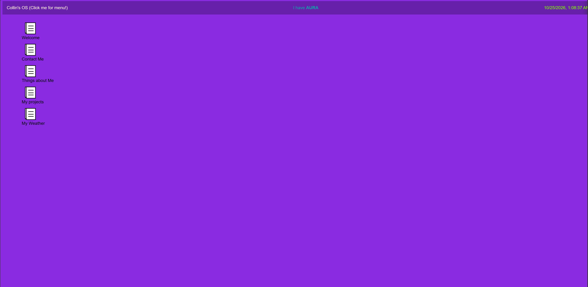

# Collin's OS
This is an OS styled website that basically explains who I am as a student in HTML, styled with CSS and functions with javascript. Made for Hack Club's Stardance.
## Features:
- Draggable windows
- OS bar that shows time
- Main menu with windows list and shut down
- Weather system
## How I made this:
I made this using hack club's guide on making website os and then changed styles and added features of my own to the website.
## Showcase

